# Microchip Character Recognition

Microchip Character Recognition

ME5411 Robot Vision and AI

Group 6 Technical Report Draft

Experiment records dated 14 October 2026

| Member | Name | Student number |
| --- | --- | --- |
| 1 | TO BE PROVIDED | TO BE PROVIDED |
| 2 | TO BE PROVIDED | TO BE PROVIDED |
| 3 | TO BE PROVIDED | TO BE PROVIDED |
| 4 | TO BE PROVIDED | TO BE PROVIDED |

Draft for group review. Member details, course-method eligibility and group-authored discussion are not yet confirmed. This document must not be represented as an approved final submission.

The assignment permits language editing with LLMs but requires ideas, analysis and reasoning to originate from the project group. This draft organizes existing implementation records, figures and measured results. Section 25 identifies the passages that the group must supply and approve.

Submission deadline 20 November 2026 at 23:59 Singapore time

## 1 Scope and recorded outcomes

This draft documents the software pipeline implemented for Tasks 1 to 7 of the ME5411 group project [1]. The fixed chip image is processed into ten character crops. A convolutional neural network implemented with NumPy and a non-CNN pipeline using standardization, PCA and an RBF SVM classify the seven character categories.

The current test split contains 1,778 images. Exact decoded duplicates are grouped before allocation to avoid identical images crossing training, validation and test sets. The CNN makes 14 errors and PCA plus SVM makes 16 errors. On the normalized chip crops, the recorded strings are HD44780A00 and H044780A00 respectively.

| Record | CNN | PCA plus SVM |
| --- | --- | --- |
| Test accuracy | 0.9921 | 0.9910 |
| Macro F1 | 0.9921 | 0.9910 |
| Test errors | 14 of 1778 | 16 of 1778 |
| Normalized chip crops | 10 of 10 | 9 of 10 |

These are observations from one fixed split and one chip photograph. They do not establish general superiority, statistical significance or performance on unseen chip photographs. Explanations and lessons learned must be supplied by the group.

Report navigation

Sections 2 to 4 cover data and evaluation. Sections 5 to 10 document Tasks 1 to 6. Sections 11 to 17 document both classifiers. Sections 18 to 22 present comparison, chip recognition and verification. Sections 23 to 26 cover reproduction, group completion and references.

## 2 Input images and labels

The supplied chip file used locally is Test_Image_2026.bmp, a 990 by 367 RGB image. The task statement names charact2.bmp. The group should confirm that the locally supplied updated image is the intended course version. The required target line is HD44780A00, comprising ten positions and seven distinct categories.

Figure 1 Original chip photograph used for image processing

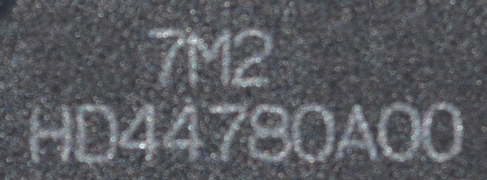

The classification dataset has seven directories named 0, 4, 7, 8, A, D and H. Each directory contains 1,016 PNG images, giving 7,112 images in total. The classifier inputs are 128 by 128 grayscale images before preprocessing. The category order is fixed consistently in task7/data.py.

Figure 2 Sample character images in category order

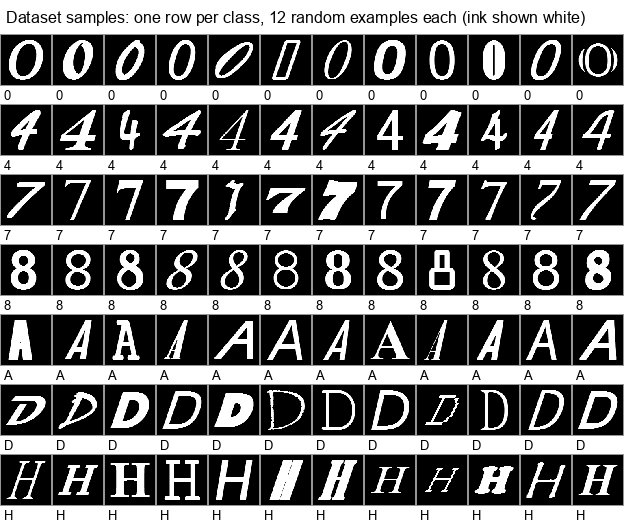

## 3 Duplicate audit and dataset allocation

Each image is decoded to grayscale and its pixel bytes are hashed with SHA-256. Groups with identical hashes are assigned wholly to one partition. The audit found 651 exact-duplicate groups and no conflicting labels. The earlier image-wise split had 370 groups crossing partitions; 253 groups appeared in both training and test. Those earlier results are retained in history but are not the current evaluation.

Within each category, groups are shuffled with seed 42. A subset-sum allocation selects whole groups to meet exact test and validation image counts; remaining groups form training data. The implementation raises an error if exact allocation without breaking groups is impossible.

| Partition | Per category | Total | Purpose |
| --- | --- | --- | --- |
| Training | 660 | 4620 | Model fitting |
| Validation | 102 | 714 | Configuration selection |
| Test | 254 | 1778 | Final evaluation |

Training and validation jointly account for 75 percent of the supplied dataset; the test partition accounts for 25 percent. Only the training subset is used to fit the current final models. Validation remains separate for model selection and checkpoint selection.

The current audit confirms complete coverage, mutually exclusive image indices, reproducibility from the grouped seed and zero exact duplicate groups crossing partitions. Pixel hashes do not detect near-duplicates or related typefaces. No author or font grouping metadata is available in the supplied directory structure.

Evidence: task7/data.py; task7/audit.py; output/task7/verification/data_audit.json

## 4 Evaluation protocol

Figure 3 Data isolation and evaluation workflow

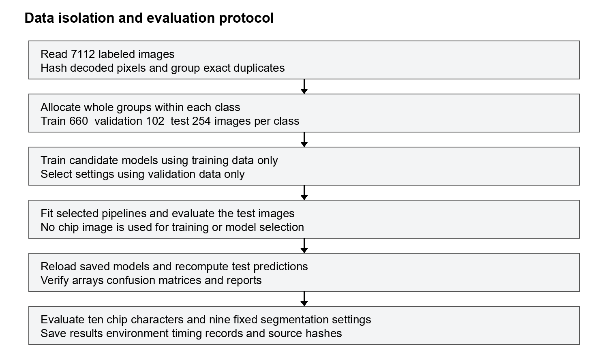

Candidate settings are ranked by validation accuracy. The test set is not used to choose preprocessing, CNN architecture, learning rate, PCA dimension or SVM kernel settings. The chip image is not used for classifier fitting or classifier selection. Test predictions are recomputed after model loading solely to check reproducibility.

## 5 Image processing workflow

Figure 4 Image processing and segmentation workflow

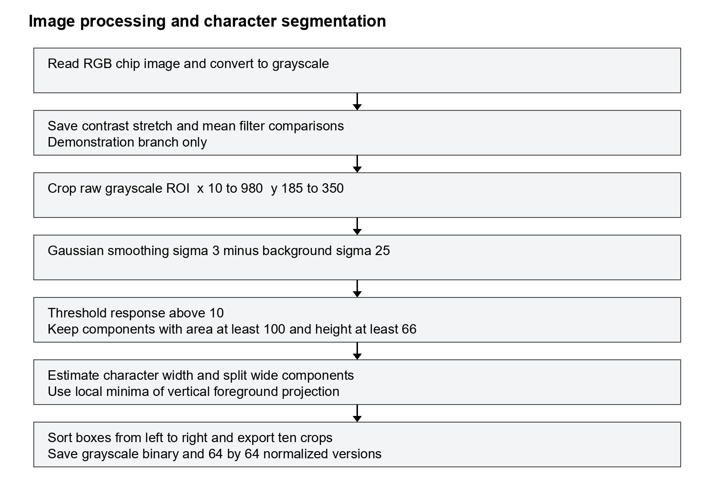

Contrast enhancement and mean filtering are saved as demonstration outputs. The actual segmentation branch uses the raw grayscale ROI, Gaussian smoothing and local background subtraction. The demonstration images are not chained into the segmentation input.

## 6 Task 1 Contrast enhancement

The RGB image is converted to grayscale with Pillow. ImageOps.autocontrast produces the saved enhancement demonstration [3]. The operation rescales the image intensity range; it does not learn parameters from classification data. Both the original and enhanced images are preserved for comparison.

Figure 5 Grayscale image after automatic contrast stretching

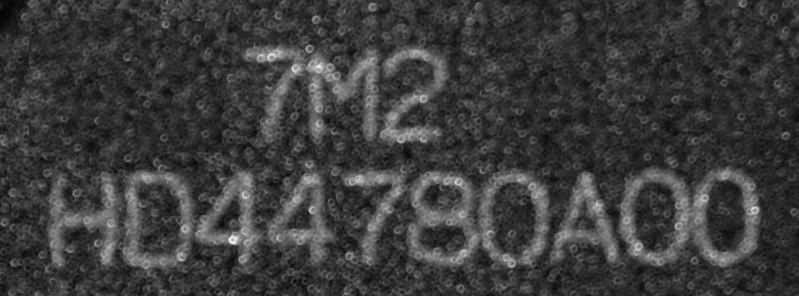

The main segmentation method uses a separate local-response operation, documented in Section 8. The code therefore exposes both a global contrast demonstration and a locally background-corrected response. The group should describe the visual changes it observes and the reasons for retaining the selected branch.

Group observation to complete

TO BE COMPLETED BY THE GROUP: describe whether character strokes and background texture become clearer or more prominent in Figure 5, and explain how this affects the later tasks. Do not infer quantitative enhancement accuracy without a reference image.

Evidence: segment_characters.py; output/segmentation/02_contrast.png

## 7 Task 2 Mean filtering

A normalized square averaging filter is implemented explicitly with NumPy. For a window of side k, the output is the sum of k squared neighborhood intensities divided by k squared. Image borders are replicated, and the resulting intensities are rounded to uint8. The required 5 by 5 filter is evaluated alongside 3 by 3 and 7 by 7 filters.

Figure 6 Mean filter with a 3 by 3 neighborhood

Figure 7 Mean filter with a 5 by 5 neighborhood

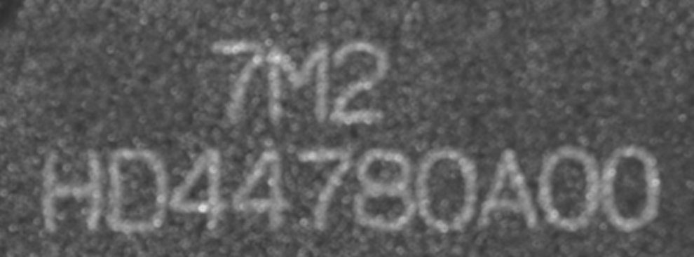

Figure 8 Mean filter with a 7 by 7 neighborhood

The mean-filter images are saved for the assignment comparison. They are distinct from the Gaussian-filter branch used for character extraction. The implementation has been checked to preserve a constant-valued image, including the replicated borders.

TO BE COMPLETED BY THE GROUP: compare background smoothing, thin-stroke visibility and neighboring-character separation across these three images, using specific observed locations.

## 8 Tasks 3 and 4 Crop and binarization

The fixed ROI has coordinates (10, 185, 980, 350), with right and bottom boundaries excluded. It is 970 by 165 pixels and contains the required character line. This is a manually selected ROI for the supplied fixed image, rather than a general text-line detector.

Figure 9 Grayscale subimage containing the required character line

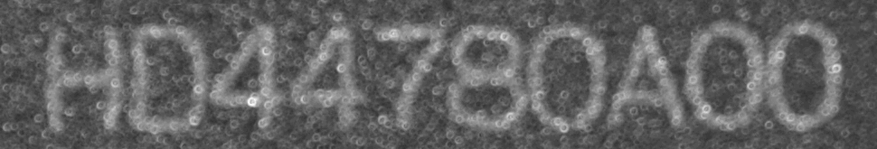

Let S be the Gaussian-smoothed crop with radius 3 and B the background estimate with radius 25. The local response is R = S - B. Foreground is defined as R greater than 10. Pillow approximates Gaussian filtering with extended box filters; its radius parameter represents the Gaussian standard deviation [4]. The response visualization adds 128 before clipping, whereas the binary threshold is applied to the unshifted floating-point response.

Figure 10 Local response visualization with an intensity offset of 128

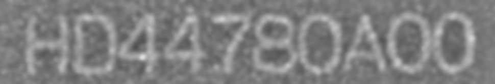

Figure 11 Binary foreground obtained from the local response

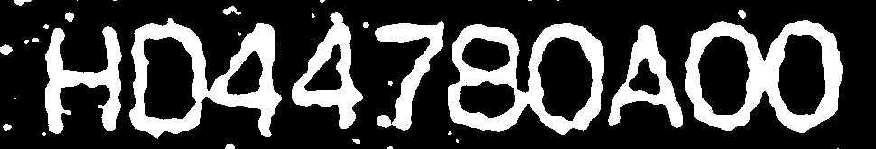

Evidence: segment_characters.py; segmentation.json

## 9 Tasks 5 and 6 Components and boundaries

Four-connected foreground components are found using an explicit stack traversal. A component is retained when its area is at least 100 foreground pixels and its height is at least 40 percent of the ROI height, equivalent to 66 pixels. The filter does not use known character labels.

Figure 12 Binary image after component area and height filtering

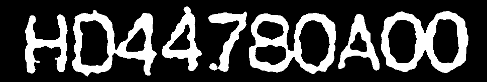

Boundary pixels are computed as foreground pixels that are not interior under a four-neighbor test. This produces both outside boundaries and boundaries surrounding character holes. The output is a boundary-pixel image; it does not encode ordered contour chains or contour hierarchy.

Figure 13 Foreground boundary pixels including character holes

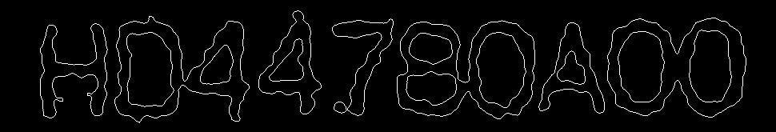

Retained connected components can contain touching characters. A later projection-based step subdivides wide components, so the number of retained components need not equal the number of exported character images.

Evidence: components and split_boxes in segment_characters.py

## 10 Touching characters and crop export

The median width of the narrower half of candidate components estimates a typical character width. A component wider than 1.45 times this estimate is treated as a possible multi-character region. The number of pieces is estimated from its width. A five-column averaged vertical foreground projection locates weak columns near the expected separation positions. No target string or fixed character count is used in this splitting step.

Figure 14 Vertical foreground projection and cuts within touching components

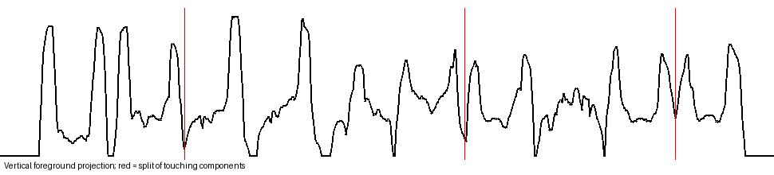

Figure 15 ROI and ten exported bounding boxes on the original image

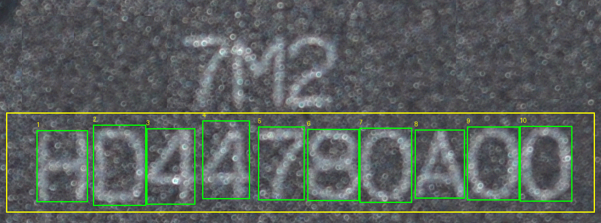

Figure 16 Exported characters in left to right order

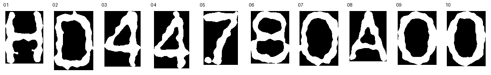

For each position, the pipeline saves a grayscale crop, a white-on-black binary crop, and a 64 by 64 normalized black-on-white crop. Normalization preserves aspect ratio, centers the image and retains a six-pixel white margin. Antialiased resizing introduces grayscale edge values. Box coordinates and foreground counts are stored in segmentation.json.

## 11 Classifier preprocessing

Both classifiers use the same category definitions and dataset partitions. Three preprocessing modes are evaluated: whole-frame resizing, ink bounding-box cropping followed by resizing, and cropping followed by square padding and resizing. The ink threshold is 128 and the crop is expanded by two pixels where possible. The resulting image tensor has ink near 1 and background near 0.

Figure 17 Preprocessing examples generated from the training partition

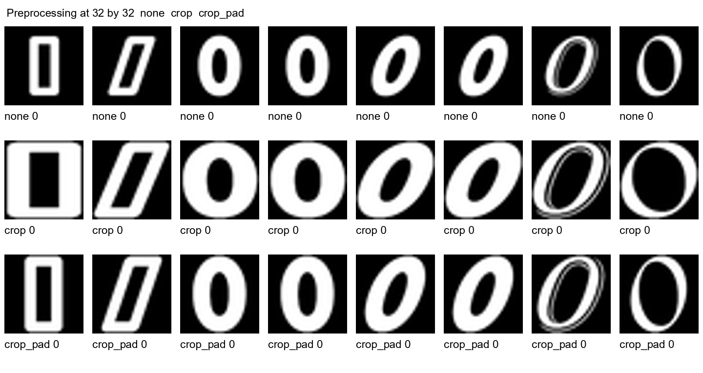

| Mode | Geometry |
| --- | --- |
| none | Resize full image |
| crop | Crop and resize with possible aspect change |
| crop_pad | Crop pad to square and resize |

The preprocessing transformation itself uses fixed operations, not fitted dataset statistics. Fitted standardization and PCA belong to the classical classifier and are restricted to training data. Cached tensors can be regenerated and are not included in the submission package.

## 12 CNN architecture and implementation

Figure 18 Selected CNN architecture

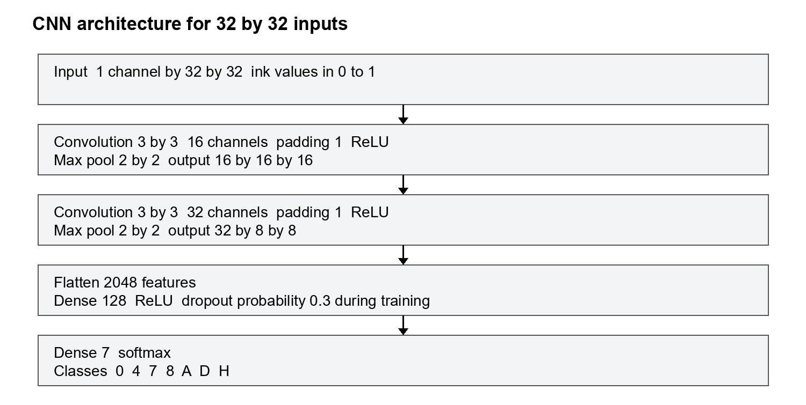

The network implements convolution through im2col and matrix multiplication, 2 by 2 max pooling, fully connected layers, ReLU, inverted dropout and softmax cross entropy. Forward and backward operations are written in NumPy [2]. The selected architecture has 267,975 trainable scalar parameters.

The model starts from seeded initialization. No pretrained OCR model or external recognition service is used. The seven-way output is mapped to the fixed category order 0, 4, 7, 8, A, D, H. Dropout is active during fitting and disabled during validation and prediction.

Evidence: task7/cnn.py; output/task7/cnn/config.json

## 13 CNN fitting and numerical checks

Mini-batches contain 64 images. The final selected learning rate is 0.003, dropout probability is 0.3 and weight-decay coefficient is 0.0001. Adam uses beta1 = 0.9, beta2 = 0.999 and epsilon = 1e-8 [8]. The implemented penalty is added to weight gradients before Adam moment updates; it is not a separate AdamW update. Reported cross entropy excludes that penalty term.

Each candidate is trained for eight epochs. The final selected model is trained for 25 epochs. Validation accuracy is computed each epoch and the best state is copied. Training does not stop early; after all epochs the best validation state is restored. In the current run, the best epoch is 5.

| Setting | Value |
| --- | --- |
| Split seed | 42 |
| Network and fitting seed | 0 |
| Final epochs | 25 |
| Batch size | 64 |
| Learning rate | 0.003 |
| Weight decay | 0.0001 |
| Dropout probability | 0.3 |

A centered finite-difference check samples six entries per parameter tensor in a small network using float64. Eight tensors are checked. The largest recorded relative error is 1.35e-6, below the configured failure threshold of 1e-4. This is a sampled numerical check, not a proof of every derivative or a complete network test.

## 14 CNN preprocessing and hyperparameter results

The seven candidate settings change preprocessing, input size, learning rate, channel widths or augmentation. Where enabled, augmentation uses translation from a padded crop and contrast or brightness jitter. Selection uses the maximum validation accuracy reached within the eight fitting epochs.

| Configuration | Validation accuracy | Best epoch | Seconds |
| --- | --- | --- | --- |
| croppad32_na | 0.9972 | 5 | 90.42 |
| croppad32 | 0.9958 | 7 | 85.56 |
| crop32 | 0.9944 | 8 | 84.86 |
| raw32 | 0.9916 | 7 | 82.92 |
| croppad32_lr | 0.9916 | 7 | 85.79 |
| croppad32_sm | 0.9916 | 6 | 39.43 |
| croppad24 | 0.9902 | 7 | 48.39 |

The recorded winner is croppad32_na: cropped and square-padded 32 by 32 inputs, channels 16 and 32, learning rate 0.003 and no random image augmentation. It reaches validation accuracy 0.9972. All configurations still use dropout during training. The paired croppad32 setting differs by using image augmentation and records validation accuracy 0.9958.

The 24 by 24 setting records 0.9902 validation accuracy. The smaller channel setting records 0.9916 and has 133,351 parameters. These values document this single-seed study. The group should explain the tradeoffs it considers justified and avoid interpreting one run as a general rule about augmentation or architecture size.

Evidence: output/task7/cnn/experiments.json

## 15 CNN training history and test errors

Figure 19 Final CNN fitting history across 25 epochs

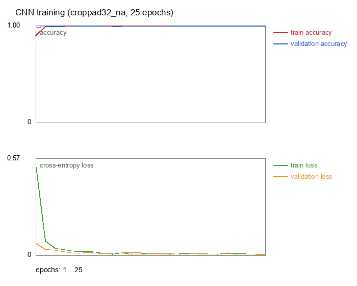

The restored checkpoint makes 14 errors on 1,778 test images, giving accuracy 0.9921 and macro F1 0.9921. The most frequent recorded confusions are H as A in six cases and A as H in three cases. Training accuracy in the history is computed on each mini-batch after its update, not as a separate complete training-set pass.

Figure 20 Saved CNN error examples with true and predicted labels

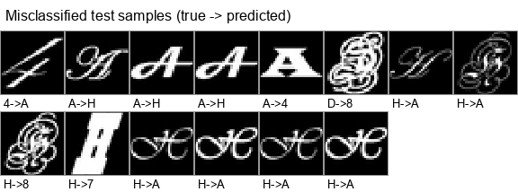

## 16 PCA and SVM method

Figure 21 Selected classical classification pipeline

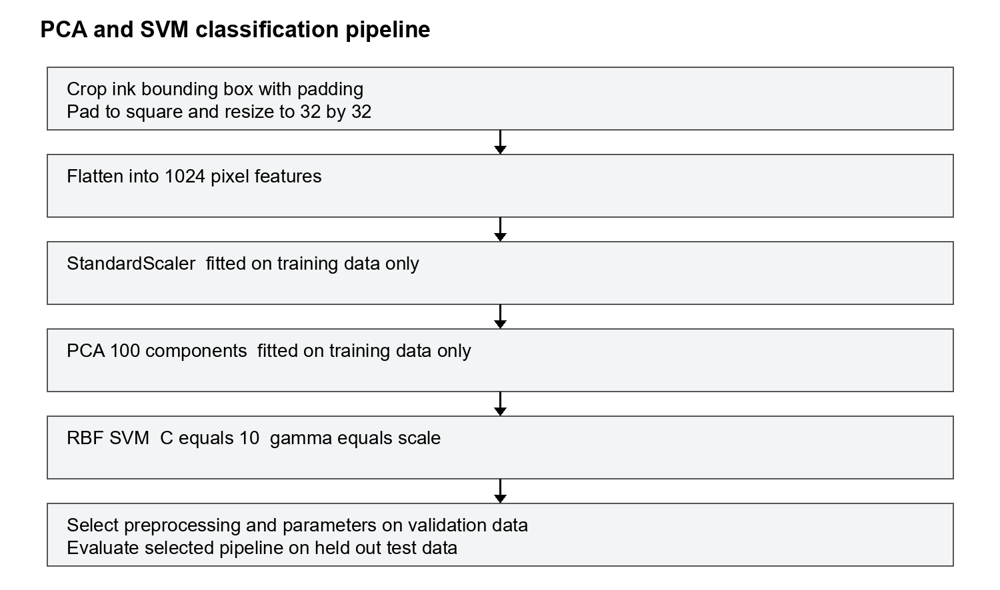

StandardScaler stores training feature means and standard deviations [5]. PCA is fitted to standardized training pixels and keeps 100 components [6]. The selected RBF SVM uses C = 10 and gamma = scale [7]. The RBF kernel compares transformed feature vectors using exp of minus gamma times squared Euclidean distance. Multiclass SVC uses the library implementation. No CNN-derived features are used.

COURSE ELIGIBILITY TO BE CONFIRMED: no Part 2 lecture notes have been supplied. External API documentation describes the algorithms but cannot prove that they were covered in this course.

## 17 Classical preprocessing and PCA experiments

The study first compares four preprocessing settings at 100 PCA components, C = 10 and gamma = scale. It then compares PCA dimensions for the selected preprocessing. The ordering of candidates resolves equal rounded validation scores by the retained candidate order; the selection is not based on test performance.

| Preprocessing | Size | Validation accuracy |
| --- | --- | --- |
| crop_pad | 32 | 0.9902 |
| crop | 32 | 0.9902 |
| crop_pad | 16 | 0.9860 |
| none | 32 | 0.9776 |

| PCA dimensions | Validation accuracy | Variance retained |
| --- | --- | --- |
| 100 | 0.9902 | 0.9161 |
| 200 | 0.9902 | 0.9643 |
| 50 | 0.9888 | 0.8431 |
| 30 | 0.9874 | 0.7733 |

Figure 22 Cumulative explained variance for the selected PCA transform

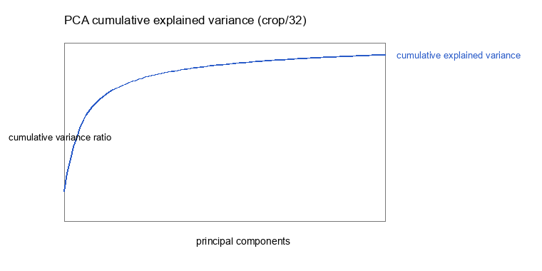

## 18 SVM kernel parameter results

After selecting preprocessing and PCA dimension, C is tested at 1, 10 and 100. Gamma is tested at scale, 0.001 and 0.01. Every fitted scaler and PCA transform in the study uses training data only. Validation labels score the candidates but do not enter their fitting.

| C | Gamma | Validation accuracy |
| --- | --- | --- |
| 10.0 | scale | 0.9902 |
| 10.0 | 0.001 | 0.9902 |
| 100.0 | scale | 0.9902 |
| 100.0 | 0.001 | 0.9902 |
| 1.0 | scale | 0.9874 |
| 1.0 | 0.001 | 0.9874 |
| 10.0 | 0.01 | 0.9258 |
| 100.0 | 0.01 | 0.9258 |
| 1.0 | 0.01 | 0.9188 |

The retained configuration uses crop_pad at 32 pixels, 100 components, C = 10 and gamma = scale. The selected PCA retains 0.9161 of standardized training variance, and the fitted SVM has 886 support vectors. Final fitting does not merge validation data into training.

Figure 23 Saved PCA plus SVM error examples

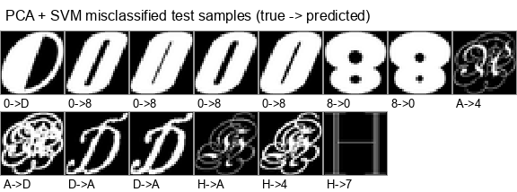

The final classical model makes 16 test errors. The most frequent confusion is A as H in seven cases. Other recorded errors include 0 as D and A as 4, each in two cases.

## 19 Effectiveness on the shared test partition

Figure 24 CNN confusion matrix with true categories by row

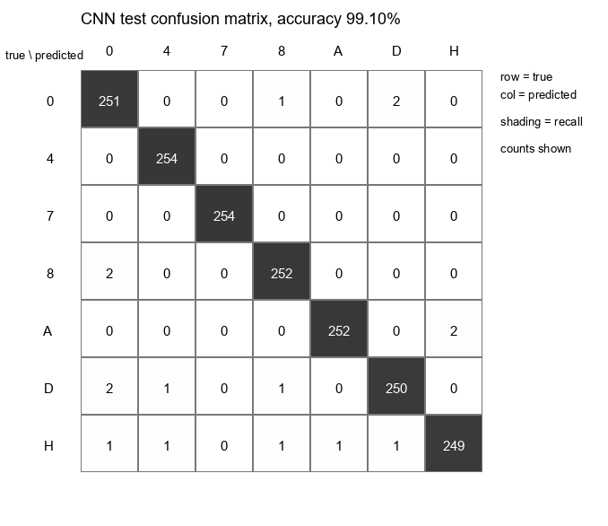

Figure 25 PCA plus SVM confusion matrix on the same test indices

There are 254 test images per category. Both matrices sum to 1,778. The CNN diagonal sums to 1,764 and the classical-model diagonal sums to 1,762. The accuracy difference is two correctly classified images on this partition.

## 20 Class metrics and paired predictions

| Class | Support | CNN F1 | PCA plus SVM F1 |
| --- | --- | --- | --- |
| 0 | 254 | 1.0000 | 0.9902 |
| 4 | 254 | 0.9961 | 0.9941 |
| 7 | 254 | 0.9980 | 1.0000 |
| 8 | 254 | 0.9961 | 0.9960 |
| A | 254 | 0.9785 | 0.9820 |
| D | 254 | 0.9980 | 0.9902 |
| H | 254 | 0.9781 | 0.9844 |

Accuracy is the number of correct predictions divided by the number of test images. For each category, precision uses predicted positives and recall uses actual positives. F1 is the harmonic mean of precision and recall. Macro F1 averages the category F1 scores. The implementation reports rounded per-class scores and macro values.

| Paired outcome | Count |
| --- | --- |
| both correct | 1752 |
| cnn only correct | 12 |
| svm only correct | 10 |
| both wrong | 4 |

Both classifiers are correct for 1,752 test images and wrong for four. Twelve images are correctly classified only by the CNN and ten only by PCA plus SVM. No confidence interval or significance claim is reported. Repeated seeds, independent font groups and additional photographs were not part of this study.

## 21 Efficiency measurement

| Measurement | CNN | PCA plus SVM |
| --- | --- | --- |
| Final fitting seconds | 299.51 | 0.96 |
| Single image ms | 0.970 | 0.780 |
| Batch ms per image | 0.779 | 0.165 |
| Model bytes | 1073874 | 1196912 |

Final fitting excludes image loading, image preprocessing and hyperparameter search for both methods. The classical timer includes scaler fitting, PCA fitting, feature transformations and SVM fitting. The CNN timer includes optimization, validation each epoch and checkpoint selection. These are costs of the implemented fitting workflows rather than identical optimization workloads.

Figure 26 Warmed inference latency including classical feature transforms

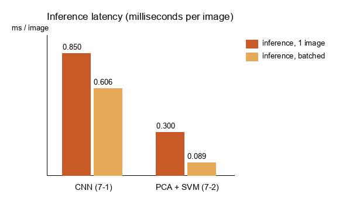

Inference starts from a preprocessed image tensor and ends at a predicted class. Both methods are warmed up and timed three times; the median is reported. Batch size is 256, and 200 single images are selected with seed 42. Classical inference includes scaler and PCA transforms. Neither timing includes file I/O or image resizing. Stored bytes are compared directly; CNN trainable parameters are not treated as equivalent to SVM and PCA stored state.

## 22 End to end chip recognition

| Input | CNN string | Hits | SVM string | Hits |
| --- | --- | --- | --- | --- |
| normalized | HD44780A00 | 10/10 | H044780A00 | 9/10 |
| gray | HHAHHHDADD | 2/10 | HDHHHHDDDD | 2/10 |
| gray_enhanced | HD4478DA0D | 8/10 | HD4H7HDDDD | 4/10 |

The expected line HD44780A00 is used only to score the predictions by position. The segmentation algorithm does not use it to decide split positions or crop count. The normalized input is the cleaned binary crop after padding and resizing. The gray input is the raw grayscale crop with polarity correction. The gray_enhanced input applies autocontrast, Gaussian smoothing of radius 1.5 and an Otsu threshold to estimate the ink bounding box.

The current normalized predictions are correct at all ten positions for the CNN and at nine positions for PCA plus SVM. Both classifiers are correct at two positions on the raw gray variant. Enhanced gray results are eight and four correct positions. These are measurements of different inputs from one photograph, not an independent multi-image robustness benchmark.

CNN displayed scores are softmax outputs. The SVM display applies softmax to decision-function scores, which are not calibrated class probabilities. They should not be interpreted as directly comparable confidence estimates.

Evidence: task7/recognize.py; output/task7/recognition/recognition.json

## 23 Segmentation parameter sensitivity

A fixed grid tests Gaussian smoothing radii 2, 3 and 4 with local thresholds 8, 10 and 12. Background radius remains 25, minimum area remains 100 and the ROI remains fixed. No classifier is retrained or selected using these chip experiments.

| Radius | Threshold | Count | CNN correct string | SVM correct string |
| --- | --- | --- | --- | --- |
| 2 | 8 | 10 | Yes | No |
| 2 | 10 | 10 | Yes | No |
| 2 | 12 | 10 | Yes | No |
| 3 | 8 | 10 | Yes | No |
| 3 | 10 | 10 | Yes | No |
| 3 | 12 | 10 | Yes | No |
| 4 | 8 | 10 | Yes | No |
| 4 | 10 | 10 | Yes | No |
| 4 | 12 | 10 | Yes | No |

All nine settings produce ten crops, the CNN string HD44780A00 and the SVM string H044780A00. Mean box intersection-over-union relative to the default boxes ranges from 0.960 to 1.000. This is a stability measure relative to the implementation output, not detection accuracy against annotated ground-truth boxes.

The ROI and splitting assumptions are specific to this supplied image. Width-based splitting assumes roughly comparable character widths; severe broken strokes, variable-width fonts, rotation, new backgrounds and other chip layouts have not been evaluated. The group should state which of these limits matter to its intended scope.

## 24 Reproducibility and software environment

The complete experiment run takes 867.8 seconds in the recorded environment. Model loading and uncached preprocessing reproduce the saved test predictions, confusion matrices and reports exactly. A separate quick run finishes successfully and SHA-256 checks confirm that all 37 pre-existing formal result files remain unchanged.

| Component | Recorded version |
| --- | --- |
| Python | 3.14.6 |
| numpy | 2.5.3 |
| Pillow | 12.3.0 |
| scikit-learn | 1.9.1 |
| scipy | 1.18.1 |

The recorded platform is Windows 11 on an AMD64 processor. OPENBLAS_NUM_THREADS, OMP_NUM_THREADS and MKL_NUM_THREADS are set to 1. Runtime measurements apply to that environment and should not be transferred directly to other machines. Core package versions are listed in requirements-tested.txt.

Run from a new copy

1  Install Python and create a virtual environment in the extracted project directory.

2  Run python -m pip install -r requirements.txt.

3  Extract dataset_2026_updated.zip into dataset_2026_updated so that dataset_2026 is the next directory.

4  Set the three thread variables to 1 as shown in README.md.

5  Run python segment_characters.py.

6  Run python -m task7.audit then python run_task7.py.

7  Run python -m task7.verify_results and python -m task7.segmentation_study.

8  Run python -m task7.report_experiments to regenerate the experiment summary.

To inspect stored models without fitting, run python -m task7.recognize after segmentation. The --quick option of run_task7.py writes to output/task7_smoke and is not a source of formal metrics. A freshly extracted review package has also passed segmentation, saved-model prediction verification and chip recognition in a new virtual environment with the recorded core package versions. Full model training was not repeated in that second environment. The acceptance record is docs/package_acceptance.json.

## 25 Group discussion and final confirmation

This section requires original group input before submission. The assignment explicitly requires group-originated ideas, analysis and reasoning [1]. No member names, student numbers, contributions, course approvals or original group conclusions have been invented in this draft.

Method rationale and lessons learned

TO BE COMPLETED BY THE GROUP: explain the chosen image-processing branch, the criteria used to judge enhancement and filtering, and the benefits or failures observed when splitting touching characters. Cite specific figures and observed positions.

TO BE COMPLETED BY THE GROUP: explain the recorded preprocessing and hyperparameter differences, the two classifiers' confusion patterns, and the cost of the implemented workflows. Separate observations from untested explanations. Include the group's lessons learned from the duplicate audit and the raw-photo experiments.

Conclusion

TO BE COMPLETED BY THE GROUP: state the project's conclusions within the measured scope, including what was achieved, what remains limited and which follow-up would be justified by the results. Avoid claiming general superiority from two errors or one photograph.

Confirmation before final export

| Required item | Current state |
| --- | --- |
| Four names and student numbers | Awaiting group information |
| PCA and SVM covered in Part 2 | Awaiting lecture evidence |
| Group discussion and conclusion | Awaiting group text and approval |
| Actual contribution statement | Awaiting member confirmation |
| Draft status removed | Only after preceding items are resolved |
| Canvas upload | Not performed |

## 26 References and implementation acknowledgments

[1] NUS ME5411 Robot Vision and AI. Group Project AY2627. Supplied assignment statement ME5411_Project_AY2627.pdf and course dataset dataset_2026_updated.zip.

[2] NumPy developers. NumPy documentation. https://numpy.org/doc/stable/

[3] Pillow contributors. ImageOps documentation. https://pillow.readthedocs.io/en/stable/reference/ImageOps.html

[4] Pillow contributors. ImageFilter documentation. https://pillow.readthedocs.io/en/stable/reference/ImageFilter.html

[5] scikit-learn developers. StandardScaler API. https://scikit-learn.org/stable/modules/generated/sklearn.preprocessing.StandardScaler.html

[6] scikit-learn developers. PCA API. https://scikit-learn.org/stable/modules/generated/sklearn.decomposition.PCA.html

[7] scikit-learn developers. SVC API. https://scikit-learn.org/stable/modules/generated/sklearn.svm.SVC.html

[8] D. P. Kingma and J. Ba. Adam A Method for Stochastic Optimization. 2014. https://arxiv.org/abs/1412.6980

Web documentation was checked on 14 October 2026. References [2] to [8] describe the tools and algorithm definitions; project scores and counts come from saved local experiment records, not these references.

NumPy implements arrays and linear algebra used by the custom CNN and explicit image operations. Pillow provides image decoding, resizing, Gaussian filtering, contrast operations and figure drawing. scikit-learn provides StandardScaler, PCA and SVC; its dependencies include SciPy. Python standard-library tools provide hashing, JSON records and archive handling. ReportLab is used only to assemble this report, not to classify characters.

This draft and its supporting implementation were prepared with AI assistance. The group must verify that its use of assistance meets the course requirements, acknowledge applicable external resources, and supply its own analysis and reasoning. This statement does not certify compliance on the group's behalf.
